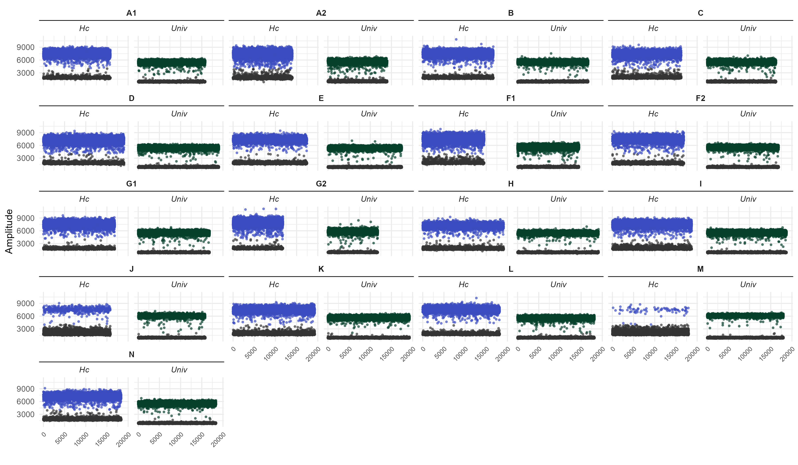
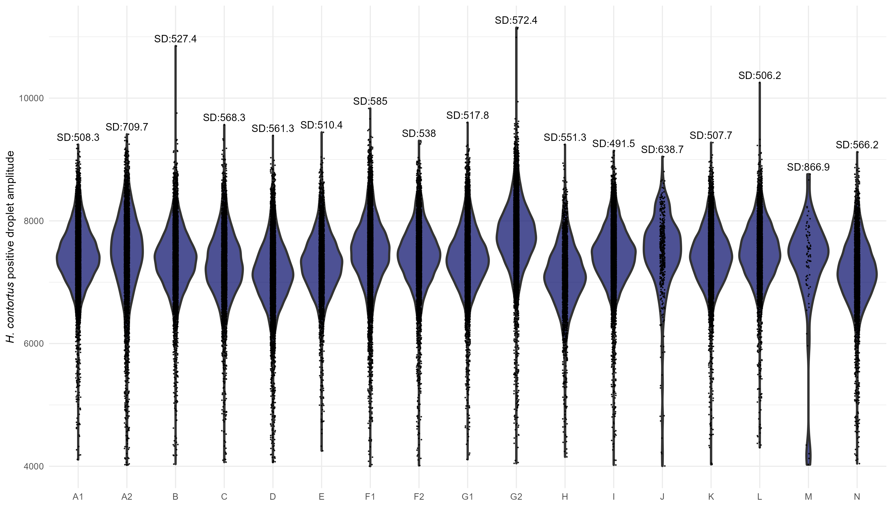
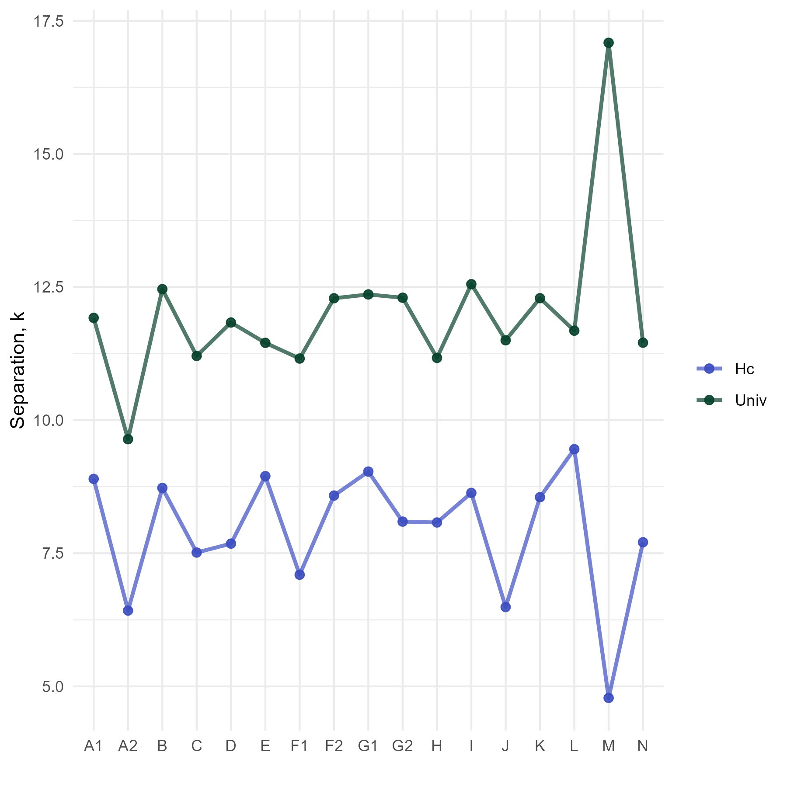
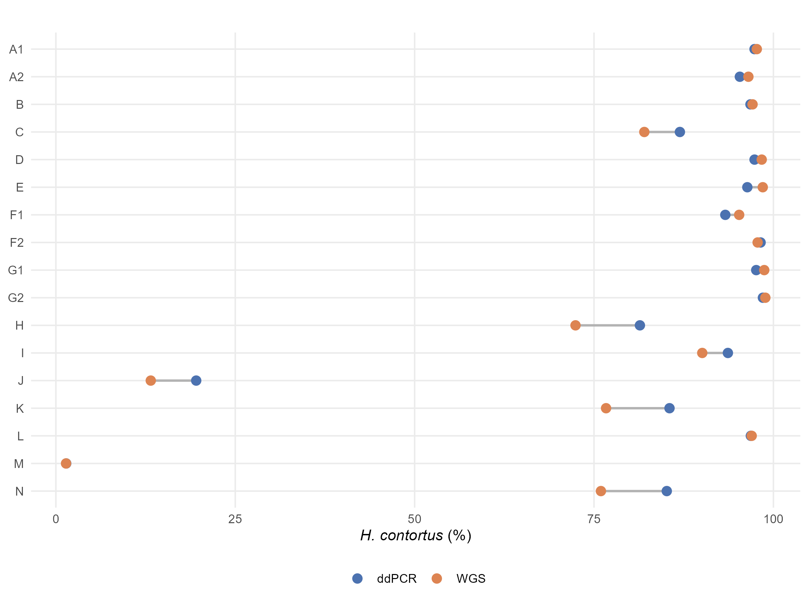
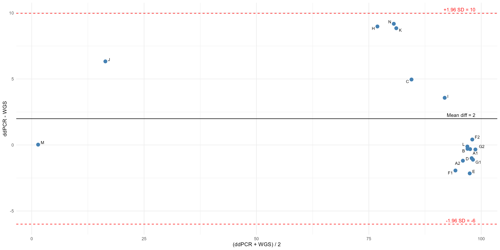

# Importing data
```r
library(tidyverse)
library(readr)
library(patchwork)

setwd("C:/Users/pauli/Desktop/SLU/data/ddPCR data pops 1-17")

# Generate a list metafile for all ddPCR .csvs
files_ddPCR<-list.files(pattern = "_Amplitude\\.csv")

# Iterate through the .csvs and save each ggplot under a variable name
## Even better - map_dfr!

combined_ddPCR <- files_ddPCR %>%
  set_names(~ str_remove(.x, "_Amplitude\\.csv$")) %>% ## every vector is a vector with it's own name
  map_dfr(
    ~ readr::read_csv(.x,skip=3, show_col_types=FALSE) %>%
            select(-starts_with("...")),
    .id = "Sample" ) %>% ## looping through every file applying a function to bind rows of each into a big table (_dfr data frame) ## adds a column .id = "Sample" to id where that file came from
  mutate(Sample = gsub("Amlan_Nancy_", "",Sample)) # edit the column source file

combined_ddPCR<- combined_ddPCR %>% group_by(Sample) %>%
  slice_sample(prop = 1) %>%  # Randomize the order of droplets
  mutate(Number=row_number()) %>%
  ungroup()
```
# Generating 1D ddPCR plots
```r
# Need a longer table format with amplitudes and Ch1 and Ch2 column in order to plot FAM and HEX together as subplots
library(ggh4x)

combined_long <- combined_ddPCR %>% 
pivot_longer(cols= c(Ch1Amplitude, Ch2Amplitude),
             names_to="Channel",values_to="Amplitude") %>%
  mutate(Status=case_when(
    Channel=="Ch1Amplitude" & Hc == 1 ~ "Ch1_pos", # When the case is that Channel==Ch1Amplitude and Hc == 1, that row is then named CH1_pos under column Status
    Channel=="Ch1Amplitude" & Hc == 0 ~ "Ch1_neg", 
    Channel=="Ch2Amplitude" & Univ == 1 ~ "Ch2_pos",
    Channel=="Ch2Amplitude" & Univ == 0 ~ "Ch2_neg"
  ))

ddPCR_plots_17<-ggplot(combined_long, aes(x=Number, y=Amplitude, colour=factor(Status))) +
  geom_point(show.legend = FALSE,size = 1, alpha = 0.7, shape = 16)+
  scale_colour_manual(values = c(
   "Ch1_pos" = "#000666", "Ch1_neg" = "#333333",
    "Ch2_pos" = "#006600", "Ch2_neg" = "#333333"
  ), name = "") +
  theme_bw(base_size = 12) +
  theme(panel.grid = element_blank()) +
  labs(x = "", y = "Ch1 Amplitude")+
 theme_minimal(base_size = 11)+
  theme(axis.text.x=element_text(angle=45, hjust=1, size=7),
        strip.text = element_text(face="bold"))+
  facet_nested_wrap(vars(Sample, Channel), ncol=8, nest_line=element_line(),strip.position = "top")
ddPCR_plots_17
```



```
# Plotting pos droplet violin plots

library(ggtext)

# Filter dataset to include HC=="1"

Violin_data_Hc <- combined_ddPCR %>% filter(Hc=="1") %>% select(Sample, Ch1Amplitude)

## calculate SDs
SDs_violin<- Violin_data_Hc %>% group_by(Sample) %>% summarize(SD=sd(Ch1Amplitude), maxx=max(Ch1Amplitude)) 

# Plot
Violin_ddpcr_plot<-ggplot(Violin_data_Hc, aes(x=Sample, y= Ch1Amplitude)) +
  geom_violin(show.legend = FALSE, size = 1, alpha = 0.7, fill="#000666")+
  geom_jitter(width = 0.05, alpha = 0.8, size = 0.1) +
  labs(y = "*H. contortus* positive droplet amplitude", x="") +
 theme_minimal(base_size = 11)+
  theme(legend.position = "none", axis.title.y = element_markdown())

Merged_violin<-Violin_ddpcr_plot+ geom_text(data=SDs_violin, aes(x= Sample, y=maxx, label=paste0("SD:", round(SD, 1))), 
                             vjust = -0.5, inherit.aes = FALSE, size=3.5)

Merged_violin<- Merged_violin+ scale_y_continuous(expand = expansion(mult = c(0.05, 0.05)))

Merged_violin
```


# Calculating k (Separability score) for each population

```r
#Calculating k separation score Mean pos amplitude / Mean neg amplitude

sep_scores_fam<- combined_ddPCR %>% group_by(Sample) %>% summarize(mean_pos= mean(Ch1Amplitude[Hc==1], na.rm=TRUE),
                                                            mean_neg= mean(Ch1Amplitude[Hc==0], na.rm=TRUE),
                                                            sd_pos=sd(Ch1Amplitude[Hc==1], na.rm=TRUE),
                                                            sd_neg=sd(Ch1Amplitude[Hc==0], na.rm=TRUE),
                                                            n_pos = sum(Hc==1),
                                                            n_neg = sum(Hc==0),
                                                            k= (mean_pos-mean_neg)/(sd_pos+sd_neg),  # Gerdes et al 2016
                                                            .groups = "drop")

sep_scores_hex<- combined_ddPCR %>% group_by(Sample) %>% summarize(mean_pos= mean(Ch2Amplitude[Univ==1], na.rm=TRUE),
                                                            mean_neg= mean(Ch2Amplitude[Univ==0], na.rm=TRUE),
                                                            sd_pos=sd(Ch2Amplitude[Univ==1], na.rm=TRUE),
                                                            sd_neg=sd(Ch2Amplitude[Univ==0], na.rm=TRUE),
                                                            n_pos = sum(Univ==1),
                                                            n_neg = sum(Univ==0),
                                                            k= (mean_pos-mean_neg)/(sd_pos+sd_neg), # Gerdes et al 2016
                                                            .groups = "drop")


# FAM #

# empirical percentile test leave-one-out
rank_test_fam<- sep_scores_fam$k

target_valJ<-sep_scores_fam$k[sep_scores_fam$Sample=="J"]
target_valM<-sep_scores_fam$k[sep_scores_fam$Sample=="M"]

withoutJ_rank_test_fam<- rank_test_fam[rank_test_fam!=target_valJ]
withoutM_rank_test_fam<- rank_test_fam[rank_test_fam!=target_valM]

# empirical percentile of target relative to others

## sample J
rank_below_J<- sum(withoutJ_rank_test_fam<target_valJ) # how many samples are smaller than the 16th 

p_percentile_J <- (rank_below_J +0.5)/(length(withoutJ_rank_test_fam) + 1) # sum of all values below/less than sample J value + 0.5 / all values without J value (n) + 1.
  # What fraction of the ref distribution (without J sample) does the sample J sit at? At which percentile! In this case its: J sample is at ~15st percentile of the distribution without it. Not extreme
p_percentile_J # 15th percentile
# Two tailed p-value

p_value_J <- 2* min(p_percentile_J, 1 - p_percentile_J) # looking at both tails (whichever is smaller p or 1-p) and doubles it 

p_value_J # p=0.29

## sample M
rank_below_M<- sum(withoutM_rank_test_fam<target_valM)

p_percentile_M <- (rank_below_M +0.5)/(length(withoutM_rank_test_fam) + 1) # Sample M value is at 3rd percentile of the distribution without it

p_percentile_M # 3rd percentile
# Two tailed p-value

p_value_M <- 2* min(p_percentile_M, 1 - p_percentile_M)

p_value_M # p=0.058

# HEX #

rank_test_hex<- sep_scores_hex$k

target_hex_valJ<-sep_scores_hex$k[sep_scores_hex$Sample=="J"]
target_hex_valM<-sep_scores_hex$k[sep_scores_hex$Sample=="M"]

withoutJ_rank_test_hex<- rank_test_hex[rank_test_hex!=target_hex_valJ]
withoutM_rank_test_hex<- rank_test_hex[rank_test_hex!=target_hex_valM]

# J sample
rank_below_J_hex<- sum(withoutJ_rank_test_hex<target_hex_valJ)

p_percentile_J_hex <- (rank_below_J_hex +0.5)/(length(withoutJ_rank_test_hex) + 1) # Sample J value is at 38th percentile

p_percentile_J_hex # 38th percentile

p_value_J_hex <- 2* min(p_percentile_J_hex, 1 - p_percentile_J_hex) 

p_value_J_hex # p=0.76

# M sample
rank_below_M_hex<- sum(withoutM_rank_test_hex<target_hex_valM)

p_percentile_M_hex <- (rank_below_M_hex +0.5)/(length(withoutM_rank_test_hex) + 1) # Sample M value is at 3rd percentile

p_percentile_M_hex

p_value_M_hex <- 2* min(p_percentile_M_hex, 1 - p_percentile_M_hex) 

p_value_M_hex # p=0.06

# Combining tables

sep_score_table<-inner_join(sep_scores_fam, sep_scores_hex, by= "Sample") %>% pivot_longer(cols=starts_with("k"), names_to = "group", values_to = "k")
# Plotting sep scores

sep_score_plot<-ggplot(sep_score_table, aes(x=Sample, y=k, color = group, group=group))+
  geom_point(size=2,alpha=0.9)+
  geom_line(size=1, alpha=0.7)+
  labs(y= "Separation, k", color="")+
  scale_color_manual(labels = c("Hc", "Univ"), values = c("#3B4CC0", "#06402B"))+ 
  theme_minimal()

sep_score_plot
```


# Plotting WGS HC % composition in samples against ddPCR results 
```r
# ddPCR vs WGS comparison for Haemonchus contortus

WGS_Hc<- bracken_prct_with_unclassified %>% filter(species=="Haemonchus contortus") %>% select(sample,prct) %>% rename(., WGS=prct) # contains Ovis aries reads, but low %

# Alternatively, without Unclassified reads. Requires "bracken_prct_norm" from Kraken2-Bracken part

WGS_without_UN_Hc<-bracken_nohost_prct_norm %>% filter(species=="Haemonchus contortus") %>% select(sample,prct) %>% rename(., WGS=prct)

ddPCR_Hc<- read.csv("C:/Users/pauli/Desktop/SLU/data/ddPCR data pops 1-17/XJ4126_1_1000_ALL17.csv") %>% 
  select(Sample.description.1, Target, Copies.20µLWell) %>% 
  rename(., sample=Sample.description.1) %>%
  mutate(sample=gsub(" ", "-", sample)) %>%
  mutate(sample=gsub("XJ*", "Sample_XJ-", sample)) %>%
  pivot_wider(names_from = Target, values_from = Copies.20µLWell ) %>%
  mutate(ddPCR=(Hc/Univ)*100)


wgs_ddpcr_combined_short<-inner_join(by="sample", ddPCR_Hc, WGS_Hc) %>% select(sample, ddPCR, WGS)

#Alternatively, with WGS_without_UN_Hc

wgs_ddpcr_without_UN_combined_short<-inner_join(by="sample", ddPCR_Hc, WGS_without_UN_Hc) %>% select(sample, ddPCR, WGS)

# Willcoxon signed rank test

wilcox.test(wgs_ddpcr_combined_short$ddPCR, wgs_ddpcr_combined_short$WGS, paired = TRUE) # p value - 1.52e-05

# Alternatively without UN reads

wilcox.test(wgs_ddpcr_without_UN_combined_short$ddPCR, wgs_ddpcr_without_UN_combined_short$WGS, paired = TRUE) # p value - 0.43

# Dumbell plot. Without UN reads

wgs_ddpcr_without_UN_combined_short$sample<-real_names[match(wgs_ddpcr_without_UN_combined_short$sample, temp_names)]

wgs_ddpcr_without_UN_combined_short$sample <- factor(wgs_ddpcr_without_UN_combined_short$sample, levels = ranked_names)

Dumbell_without_UN<- wgs_ddpcr_without_UN_combined_short

Dumbell_without_UN$sample <- factor(Dumbell_without_UN$sample, levels = rev(ranked_names))


Dumbell_without_UN_long<- Dumbell_without_UN %>% pivot_longer(cols = c(ddPCR, WGS), names_to = "Method", values_to = "Frequency")

dumbell_plot_without_UN<- ggplot() + geom_segment(data=Dumbell_without_UN, aes(x=ddPCR, xend=WGS, y=sample, yend=sample), color="gray70", linewidth = 0.8) + 
  geom_point(data=Dumbell_without_UN_long, aes(x=Frequency, y=sample, color=Method), size=2.8) + 
  scale_color_manual(values = setNames(c("#4C72B0", "#DD8452"), c("ddPCR", "WGS")
    )) +
    labs(x = "*H. contortus* (%)", y = NULL, color = NULL,
         title = "")  +
    theme_minimal(base_size = 11) +
    theme(legend.position = "bottom",
          panel.grid.minor = element_blank(),
          axis.title.x = element_markdown())

dumbell_plot_without_UN
```


# Bland-Altmann plot
```r
# Bland-Altmann plotting

baltmann_without_UN<- wgs_ddpcr_without_UN_combined_short %>% mutate(mean_val= (ddPCR+WGS)/2,
                                               diff_val= ddPCR-WGS)


#baltmann_without_UN$sample<-real_names[match(baltmann_without_UN$sample, temp_names)]


mean_diff_without_UN<- mean(baltmann_without_UN$diff_val)
sd_diff_without_UN<- sd(baltmann_without_UN$diff_val)

upper_limit_without_UN<-mean_diff_without_UN+ 1.96*sd_diff_without_UN
lower_limit_without_UN<-mean_diff_without_UN-1.96*sd_diff_without_UN


baltmann_plot_without_UN<-ggplot(baltmann_without_UN, aes(x=mean_val, y=diff_val))+
  geom_point(size=3, color="steelblue")+
  geom_hline(yintercept = mean_diff_without_UN, colour = "black", linetype = "solid")+
  geom_hline(yintercept = upper_limit_without_UN, colour = "red", linetype = "dashed")+
  geom_hline(yintercept = lower_limit_without_UN, colour = "red", linetype = "dashed")+
  annotate("text", x=max(baltmann_without_UN$mean_val), y=mean_diff_without_UN,
           label= paste0("Mean diff = ", round(mean_diff_without_UN, 1)),
           vjust=-0.5, hjust=1, size=3.5)+
   annotate("text", x=max(baltmann_without_UN$mean_val), y=upper_limit_without_UN,
           label= paste0("+1.96 SD = ", round(upper_limit_without_UN, 1)),
           vjust=-0.5, hjust=1, size=3.5, color="red")+
   annotate("text", x=max(baltmann_without_UN$mean_val), y=lower_limit_without_UN,
           label= paste0("-1.96 SD = ", round(lower_limit_without_UN, 1)),
           vjust=-0.5, hjust=1, size=3.5, color="red")+
  ggrepel::geom_text_repel(aes(label=sample), size=3)+
  labs(x = "(ddPCR + WGS) / 2",
       y = "ddPCR - WGS") + theme_minimal()

baltmann_plot_without_UN
```

